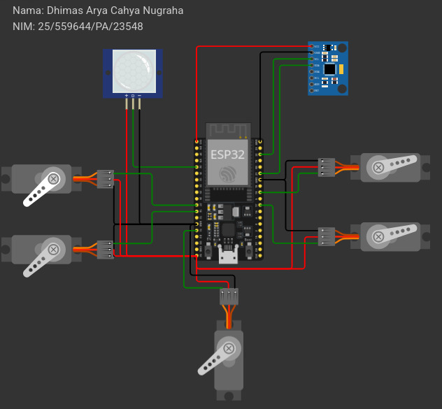
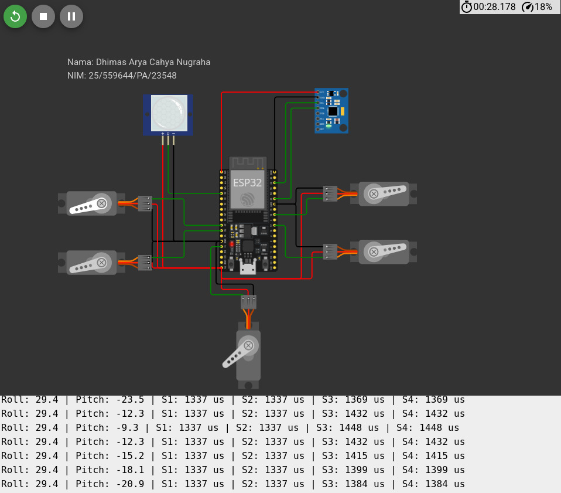
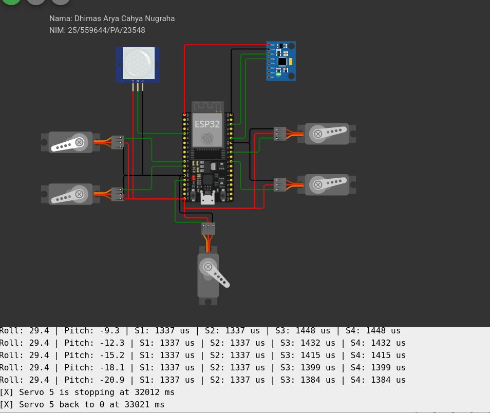

# Dhimas Arya Cahya Nugraha - Magang GMRT Day 3

## Profile

| | |
|---|---|
| Nama | Dhimas Arya Cahya Nugraha |
| NIM | 25/559644/PA/23548 |

## Description

Simulasi sistem robot berbasis ESP32 yang menggerakkan 5 servo berdasarkan orientasi sistem dan deteksi gerakan eksternal.

- **Mikrokontroler**: ESP32 DevKit
- **Sensor**:
  - MPU6050 (IMU accelerometer dan gyroscope), sebagai pengganti BNO055 yang tidak tersedia di Wokwi
  - PIR sensor (deteksi gerakan eksternal)
- **Aktuator**: 5 motor servo
- **Protokol komunikasi**:
  - I2C untuk membaca data IMU (SDA = GPIO21, SCL = GPIO22)
  - PWM 50 Hz (periode 20 ms) untuk mengontrol servo, 1000 us = -90 derajat, 1500 us = 0 derajat, 2000 us = 90 derajat

Roll dan pitch dihitung dari accelerometer menggunakan `atan2`, sedangkan yaw dideteksi dari kecepatan putar gyroscope sumbu Z. Perilaku Servo 5 dan PIR menggunakan state machine berbasis `millis()` sehingga pembacaan sensor tidak terblokir oleh `delay()`.

### Konfigurasi Pin

| Komponen | Pin ESP32 |
|---|---|
| Servo 1 | GPIO27 |
| Servo 2 | GPIO14 |
| Servo 3 | GPIO17 |
| Servo 4 | GPIO18 |
| Servo 5 | GPIO13 |
| PIR (OUT) | GPIO34 |
| MPU6050 SDA | GPIO21 |
| MPU6050 SCL | GPIO22 |

### Schematic

## Feature Table

| Fitur | Input (Sensor) | Output (Aktuator) | Perilaku |
|---|---|---|---|
| Roll | MPU6050 (accelerometer) | Servo 1 dan 2 | Berputar berlawanan arah dengan roll, sebesar sudut roll (dibatasi -90 sampai 90 derajat) |
| Pitch | MPU6050 (accelerometer) | Servo 3 dan 4 | Berputar searah dengan pitch, sebesar sudut pitch (dibatasi -90 sampai 90 derajat) |
| Yaw | MPU6050 (gyroscope sumbu Z) | Servo 5 | Bergerak ke 90 derajat (yaw positif) atau -90 derajat (yaw negatif) saat berputar. Setelah rotasi berhenti, diam 1 detik lalu kembali ke 0 derajat |
| Gerakan Eksternal | PIR sensor | Servo 1 sampai 5 | Saat gerakan terdeteksi, semua servo serentak ke 45 derajat selama 1 detik, lalu serentak kembali ke 0 derajat. Memiliki prioritas tertinggi |

## How to Run

### Link Simulasi

- Wokwi: [Link Wokwi](https://drive.google.com/file/d/1PKtFY9BMWkBCvSiRK8zcQoLQAFZvKBSP/view?usp=sharing)
- Video simulasi: [Link Video](https://drive.google.com/file/d/1PKtFY9BMWkBCvSiRK8zcQoLQAFZvKBSP/view?usp=sharing)

### Library yang Dibutuhkan

- Adafruit MPU6050
- Adafruit Unified Sensor
- ESP32Servo

Di Wokwi, library sudah tercantum di `libraries.txt` dan akan terpasang otomatis.

### Memulai Simulasi

1. Buka link Wokwi di atas.
2. Tekan tombol **Start Simulation**.
3. Buka **Serial Monitor** untuk melihat output.

### Memicu Input Uji

Klik komponen sensor saat simulasi berjalan untuk mengubah nilainya.

**Roll dan Pitch (Kasus Uji 1: roll 30 derajat, pitch -20 derajat)**
Ubah X,Y, Z pada accelerometer MPU6050 sehingga roll bernilai 30 dan pitch bernilai -20.

**Yaw (Kasus Uji 2)**

Pada MPU6050, geser rotation Z ke nilai positif atau negatif, lalu kembalikan ke 0. Servo 5 akan diam selama 1 detik, lalu kembali ke 0 derajat. Serial Monitor mencatat waktu berhenti dan waktu kembali.

**Gerakan Eksternal**

Klik PIR sensor, lalu tekan tombol simulasi gerakan. Semua servo akan bergerak serentak ke 45 derajat, lalu kembali ke 0 derajat.

## Asumsi

1. MPU6050 dipakai sebagai pengganti BNO055 karena BNO055 tidak tersedia di Wokwi.
2. Arah positif roll, pitch, dan yaw mengikuti aturan tangan kanan sesuai diagram sumbu.
3. Servo 1 sampai 4 berputar 1:1 terhadap sudut roll/pitch.
4. Yaw dianggap berputar jika kecepatannya lebih dari 5 derajat/detik.
5. PIR terpicu saat sinyal berubah dari LOW ke HIGH, dan input IMU diabaikan selama PIR aktif.
